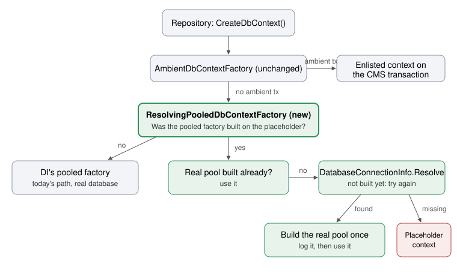

# Architecture: Survive the installer restart without a connection string

A new factory sits between the ambient factory and EF Core's pooled factory. While the pooled factory was built on the placeholder, it looks for a real connection string on every `CreateDbContext`. When it finds one, it builds a real pool once and uses that from then on. Core and OpenIddict both register their contexts through one shared helper, so there is one copy of this logic.



## Decisions
- **Look for the connection string on each create while on the placeholder**, not on a CMS notification after the installer's restart. A notification would miss a connection string that appears any other way.
- **Raise OpenIddict's minimum core version in the release PR, not this one.** It's in `Directory.Packages.props`, today `[18.5.1, 18.999.999)`. Nightly core builds stay below the next minor, so raising it here would break nightly OpenIddict packages.
- **Fix it in the shared seam, `EnlistDbContextFactoryInAmbientScope`**, not in each repository or background service. Every Automate and OpenIddict repository, the WorkflowCore persistence provider, the outbox, stuck-run recovery and the credential cleanup all get their factory from there, so they all recover together.
- **Wrap DI's pooled factory, and build a second pool only when the first was built on the placeholder**, not one pool owned by the wrapper for every site. A site that has its connection string at boot keeps today's exact path, apart from one flag check per create.
- **Record the placeholder when the options are built**, through a per-context state singleton that the shared options delegate sets. It isn't inferred from the built options' connection string, which would tie the check to EF Core internals.
- **Build the real pool with `PooledDbContextFactory<T>`'s public constructor**, with the same provider setup and interceptors as the DI pool and the same default pool size (1024). Build it once, under a lock, and never replace it.
- **One internal registration helper in Core, used by both contexts (#532).** Each caller passes its provider setup, its enlisted-context builder and its warning text. It's internal because OpenIddict already uses Core internals through `InternalsVisibleTo`.
- **No public API changes**, so no `[Obsolete]` shims. Every type and method touched is internal. `DatabaseConnectionInfo` stays as it is, apart from the `PlaceholderConnection` remarks.
- **No CMS changes, and no forced process restart.** Ruled out in the brief.

## What changes

**Server: Core**

```text
Umbraco.Automate/src/Umbraco.Automate.Core/Persistence/
├── DatabaseConnectionInfo.cs                    # PlaceholderConnection remarks: no longer "restart into Run"
└── Scoping/
    ├── AmbientDbContextFactoryExtensions.cs     # new shared AddAutomatePooledDbContext<T>(...); Enlist wraps the pool in the resolving factory
    ├── ResolvingPooledDbContextFactory.cs       # new: placeholder check, Resolve, build the real pool once
    └── PlaceholderConnectionState.cs            # new: per-context "built on the placeholder" flag
```

**Server: Persistence (core)**

```text
Umbraco.Automate/src/Umbraco.Automate.Persistence/Configuration/
└── UmbracoBuilderExtensions.cs   # AddUmbracoAutomateDbContext calls the shared helper; AutomatePooledDbContextOptions shrinks to the provider + readiness interceptor setup; new warning text
```

**Server: OpenIddict**

```text
Umbraco.Automate.OpenIddict/src/Umbraco.Automate.OpenIddict.Core/Configuration/
└── UmbracoBuilderExtensions.cs   # AddOpenIddictDbContext calls the shared helper; OpenIddictPooledDbContextOptions' resolve-or-fallback copy goes
```

**Tests**

```text
Umbraco.Automate/tests/Umbraco.Automate.Tests.Integration/
├── ResolvingPooledDbContextFactoryTests.cs      # new: boot with no connection string, then add one
└── AmbientDbContextFactoryCompositionTests.cs   # still passes; extended if the registration shape changes
Umbraco.Automate.OpenIddict/tests/Umbraco.Automate.OpenIddict.Tests.Integration/
└── PooledDbContextOptionsTests.cs               # follows the shared helper
```

**Docs**

```text
docs/
└── engineering-spec.md   # "Persistence registration" paragraph: the factory now picks up a connection string that appears after boot
```

- **Logging:** one warning per context at boot when no connection string is configured, as today but with new text. One information line per context when the real connection is picked up.
- **Readiness:** unchanged. `AutomateReadinessInterceptor` is on the real pool exactly as on the DI pool, so writes still wait for Automate's migrations.

Not touched: data model and migrations (none), Management API and backoffice (none), Deploy (no entity), cache refreshers (nothing cached from the database by this code), `UmbracoAmbientAutomateConnection` (already re-checks until it resolves), `TriggerSubscriptionRegistry` (throws rather than caching on the placeholder, so it recovers on the next call), `WorkflowHostLifecycle` hardening (follow-up issue, per the brief).
