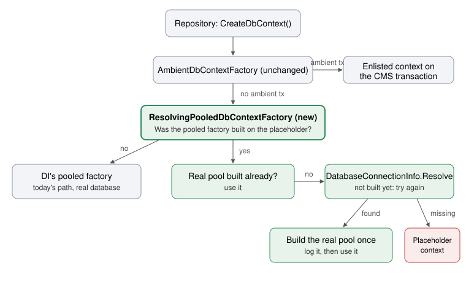

Closes #531 · Closes #532 · [Plan folder](https://github.com/umbraco/Umbraco.Automate/tree/eb7077cc55a65335a6d69af799707b1ea01bf203/docs/plans/531-lazy-dbcontext-factory)

> [!IMPORTANT]
> **1 choice was made without you.** Please check it.
>
> **1. Design: a compatibility shim for released OpenIddict**\
> Plan said: no public API changes, so no `[Obsolete]` shims.\
> Built: [an `[Obsolete]` internal `EnlistDbContextFactoryInAmbientScope` with its original signature](https://github.com/umbraco/Umbraco.Automate/blob/eb7077cc55a65335a6d69af799707b1ea01bf203/Umbraco.Automate/src/Umbraco.Automate.Core/Persistence/Scoping/AmbientDbContextFactoryExtensions.cs#L109), removed in v19. Released `Umbraco.Automate.OpenIddict@18.1.5` calls this internal method through `InternalsVisibleTo` and accepts any Core from 18.5.0. Without the shim, a site that upgrades Core but not OpenIddict fails at startup with `MissingMethodException`. With it, that site boots, but OpenIddict's half of #531 stays unfixed until OpenIddict is upgraded too.
>
> - **A. Keep the shim until v19** *(recommended)*
> - B. Drop it and call out the break in the release notes

## Why the change

After the backoffice installer's in-process restart, Automate and OpenIddict kept using the in-memory placeholder database. The site went down right after you clicked Install, or backoffice login returned 500. Now they pick up the real connection string without a process restart.

## How to verify

1. Make a fresh demo site with no connection strings, `Umbraco:Automate:UseNamedConnectionString: umbracoDbDSN`, and unattended install off. Start it. The log shows the new warning once for Automate and once for OpenIddict: "…stays inactive until one is configured. A connection string added by the installer is picked up straight away; one added any other way needs the application to restart."
2. Complete the backoffice installer with SQLite. The log shows `RestartRuntimeStep`, Automate's migrations, then "Umbraco Automate found its database connection string and is now using it." The site stays up, and there are no "no such table" errors.
3. Without restarting, log in. Login works (it returned 500 before).
4. Create a workspace and a Manual automation with a Log Message step, then publish and run it. The run reaches Completed.
5. About three minutes after boot, the OAuth credential cleanup runs. The log shows "Umbraco Automate OpenIddict found its database connection string…" and no cleanup error.

I ran all five on a fresh demo. The details are in [BUILD-LOG.md, T5](https://github.com/umbraco/Umbraco.Automate/blob/eb7077cc55a65335a6d69af799707b1ea01bf203/docs/plans/531-lazy-dbcontext-factory/BUILD-LOG.md).

Tests: 18 new specs. Core has 2,391 unit and 286 integration tests passing; OpenIddict has 132 unit and 15 integration.

## Good to know

- **Release step, not in this PR:** OpenIddict now calls `AddAutomatePooledDbContext`. The release that ships this must raise OpenIddict's `Umbraco.Automate.Core` floor (`Directory.Packages.props`, today `[18.5.1, 18.999.999)`) to that Core version (plan T8). It isn't raised here, because nightly Core builds sit below the next minor.
- **Left out:**
  - The v17 port (plan T7), which follows this PR. It needs the same shim for released OpenIddict 17.x.
  - #569, "Engine: A stuck-run recovery error stops the whole site" (`WorkflowHostLifecycle` lets the exception escape).
  - Sharing the connection-string lookup between the factory, the options delegate and `ResolveProviderName` (`DatabaseConnectionInfo.TryResolve`), which was a review suggestion.
- **Behaviour on a configured site is unchanged:** a site that has its connection string at boot uses EF Core's pooled factory exactly as before, apart from one flag check per create.
- **No public API change** in either package. Everything new is internal.

## Change outline

How a context gets created now. The green boxes are new.



Where the code went:

```diff
 Umbraco.Automate/src/Umbraco.Automate.Core/Persistence/
 ├── DatabaseConnectionInfo.cs                      # PlaceholderConnection remarks: temporary, not "until restart"
 └── Scoping/
     ├── AmbientDbContextFactoryExtensions.cs       # new AddAutomatePooledDbContext<T>; Enlist is private + [Obsolete] shim
+    ├── ResolvingPooledDbContextFactory.cs         # looks for the connection string while on the placeholder, builds the real pool once
+    └── PlaceholderConnectionState.cs              # "built on the placeholder" flag, set by the options delegate
 Umbraco.Automate/src/Umbraco.Automate.Persistence/Configuration/
 └── UmbracoBuilderExtensions.cs                    # AddUmbracoAutomateDbContext calls the helper; fallback copy removed
 Umbraco.Automate.OpenIddict/src/Umbraco.Automate.OpenIddict.Core/Configuration/
 └── UmbracoBuilderExtensions.cs                    # AddOpenIddictDbContext calls the helper; second fallback copy removed (#532)
```

What a caller passes to the shared helper:

```text
AddAutomatePooledDbContext<TDbContext>(
    configureProvider,       // (sp, options, connectionString, providerName): provider setup + interceptors
    createEnlistedContext,   // (sp, connection, providerName): context on the ambient CMS transaction
    placeholderWarning,      // logged once when no connection string resolves
    foundMessage,            // logged once when the real connection is picked up
    loggerCategory)
```

<details>
<summary>Checked and fine (5)</summary>

- [The real pool calls `UseApplicationServiceProvider`](https://github.com/umbraco/Umbraco.Automate/blob/eb7077cc55a65335a6d69af799707b1ea01bf203/Umbraco.Automate/src/Umbraco.Automate.Core/Persistence/Scoping/ResolvingPooledDbContextFactory.cs), the same as EF Core's own options building.
- [Log lines use the `{Message}` template](https://github.com/umbraco/Umbraco.Automate/blob/eb7077cc55a65335a6d69af799707b1ea01bf203/Umbraco.Automate/src/Umbraco.Automate.Core/Persistence/Scoping/AmbientDbContextFactoryExtensions.cs#L81), so the text renders exactly as passed.
- The placeholder pool isn't disposed early. It's a DI singleton, so the container disposes it at shutdown.
- Both `*PooledDbContextOptions.Configure` methods now take non-nullable strings. They're internal and each has one caller.
- The warning keeps "needs the application to restart": a connection string added outside the installer is picked up, but Automate's migrations only run at startup, so the tables wouldn't exist without a restart.

</details>

🤖 Generated with [Claude Code](https://claude.com/claude-code)

https://claude.ai/code/session_01NNrj1Mvq7ySbAqT8r6DGfj
