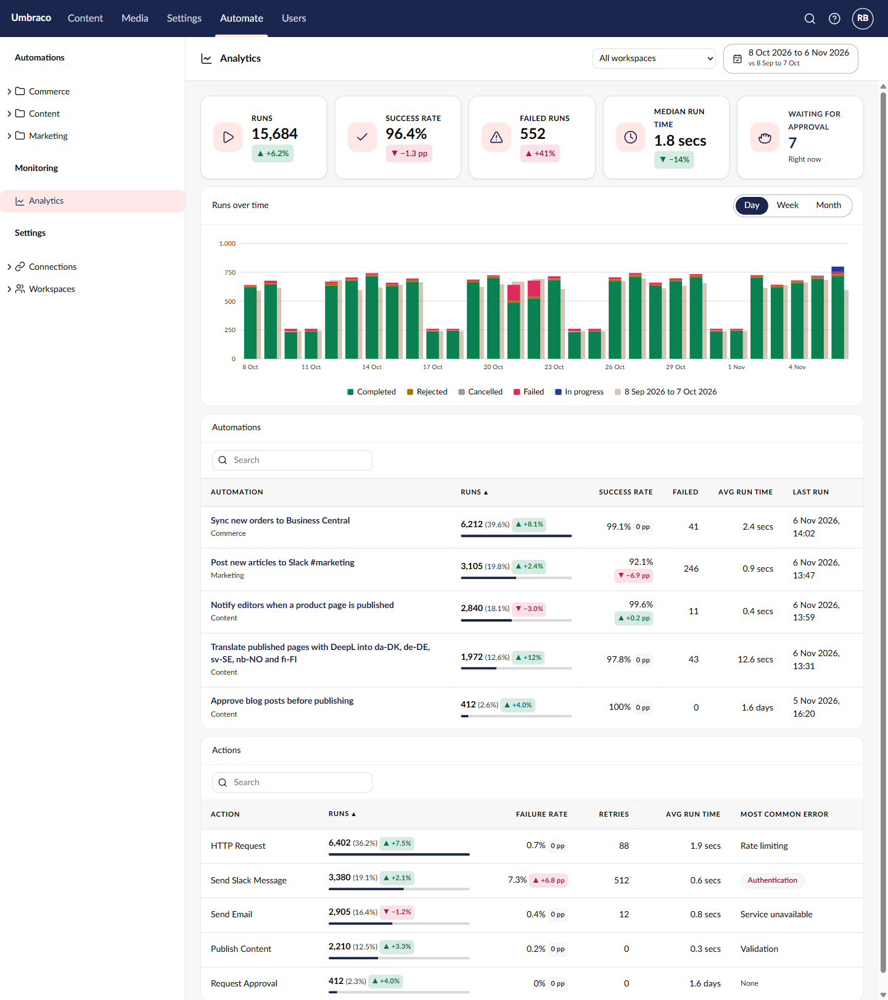
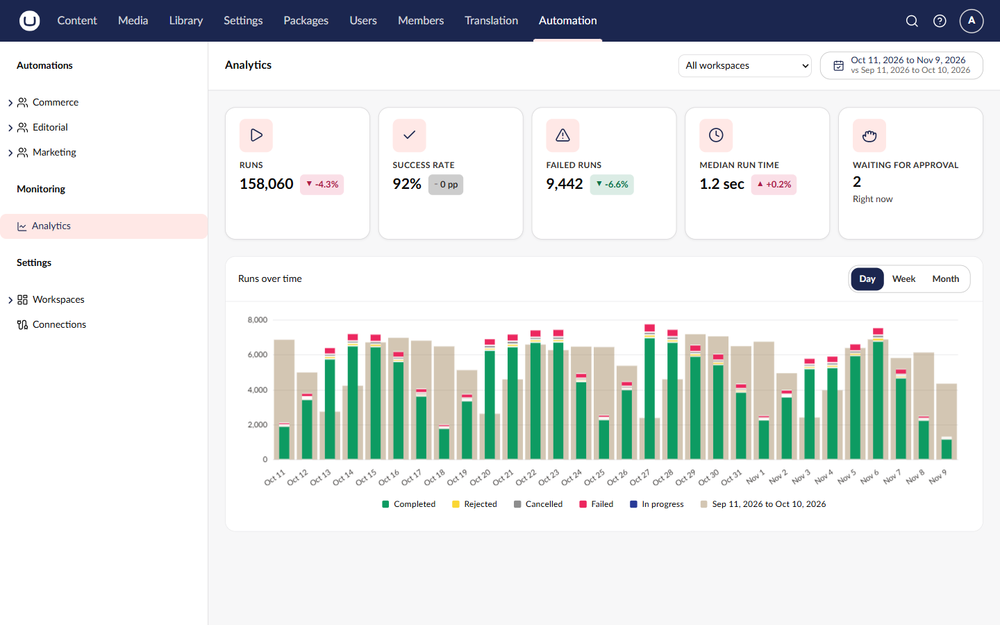
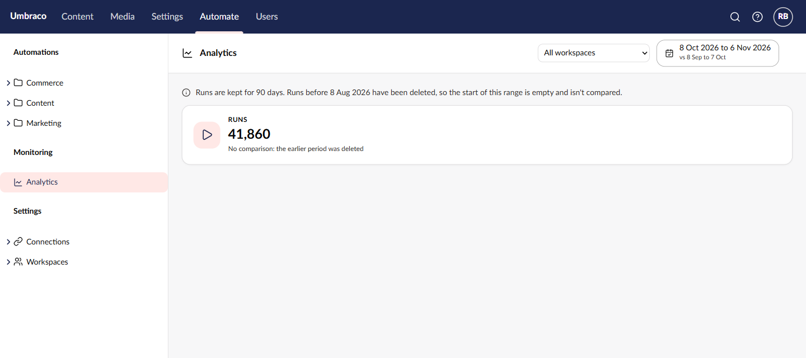
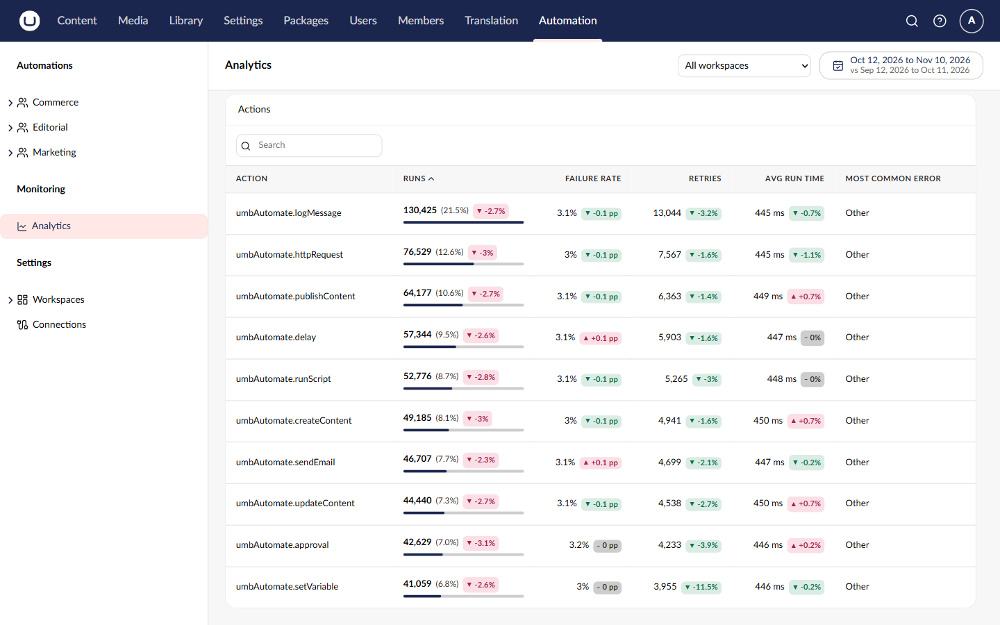
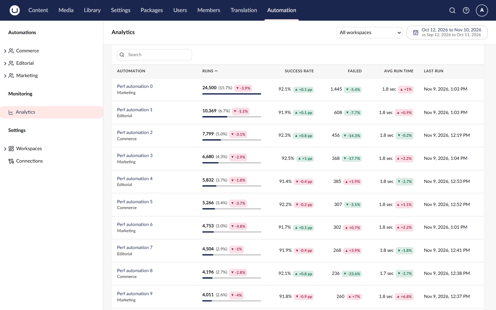
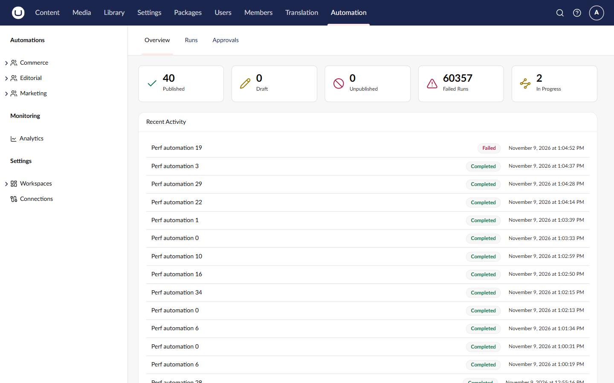
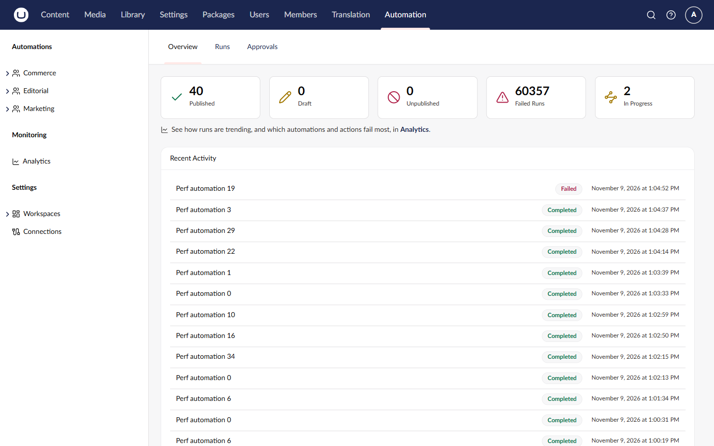

[Plan folder](https://github.com/umbraco/Umbraco.Automate/tree/v19/feature/analytics/docs/plans/analytics) | Related: [umbraco/Umbraco-CMS#24527](https://github.com/umbraco/Umbraco-CMS/issues/24527)

> [!NOTE]
> **9 choices were made without the feature owner. All reviewed on 10-11-2026:** 8 kept as recommended, and #1 changed in 4e2597aa (the service now returns `DateOutOfRange`). Kept here for the record.
>
> **1. Design: the public analytics service throws on extreme dates**\
> Plan said: R10 lists the statuses the service returns for a bad query.\
> Built: [the 2000–2999 date bounds are checked only in the controller](https://github.com/umbraco/Umbraco.Automate/blob/5c6d360c36b89c0df1a059bb6e5748bdcc617b81/Umbraco.Automate/src/Umbraco.Automate.Web/Api/Management/Metrics/Controllers/AnalyticsMetricsController.cs#L22), so another caller of the public `IAutomateAnalyticsService` with, say, 9999-12-31 gets an exception, not a status.
>
> - **A. Add `AnalyticsQueryStatus.DateOutOfRange` and move the check into the service before 19.0.0 ships** *(recommended; done in 4e2597aa)*
> - B. Leave it: only the controller calls the service today.
>
> **2. Behavior: one-workspace actions are slower than the target on small SQL Server**\
> Plan said: AN-1: under 2 seconds for 500k runs; scope by the automation's current workspace.\
> Built: [scoping joins step runs to automations](https://github.com/umbraco/Umbraco.Automate/blob/5c6d360c36b89c0df1a059bb6e5748bdcc617b81/Umbraco.Automate/src/Umbraco.Automate.Persistence/Analytics/EFCoreAutomateAnalyticsRepository.cs#L350). All workspaces is under 2 s on 1M runs, but the Actions box for one workspace took 1.6–2.7 s on LocalDB.
>
> - **A. Keep it; revisit only if real sites report it** *(recommended)*
> - B. Scope step runs by the run's own `WorkspaceId` snapshot, which changes which workspace a moved automation's old runs count under.
>
> **3. Behavior: cancelled steps don't count toward an action's failure rate or time**\
> Plan said: Nothing about cancelled steps (R4 counts a cancelled *run* as finished).\
> Built: [a finished step is Completed, Failed or Rejected](https://github.com/umbraco/Umbraco.Automate/blob/5c6d360c36b89c0df1a059bb6e5748bdcc617b81/Umbraco.Automate/src/Umbraco.Automate.Persistence/Analytics/EFCoreAutomateAnalyticsRepository.cs#L37). A step is only cancelled while waiting for approval, so its time is mostly waiting.
>
> - **A. Keep: count them as runs only** *(recommended)*
> - B. Count them as finished, like runs.
>
> **4. Behavior: weeks start on Monday for Umbraco's `en`**\
> Plan said: Week start comes from the user's culture.\
> Built: [a bare `en` is read as `en-GB`](https://github.com/umbraco/Umbraco.Automate/blob/5c6d360c36b89c0df1a059bb6e5748bdcc617b81/Umbraco.Automate/src/Umbraco.Automate.Web.StaticAssets/Client/src/analytics/analytics-adapter.ts#L43), because Umbraco's `en` is UK English but the browser reads it as US English (Sunday weeks).
>
> - **A. Keep** *(recommended)*
> - B. Follow the browser's reading of `en` (Sunday).
>
> **5. Behavior: no change badge when the previous value was 0**\
> Plan said: Nothing about a previous value of 0.\
> Built: [no percent badge for Runs, Failed runs or Median time when the earlier period had 0](https://github.com/umbraco/Umbraco.Automate/blob/5c6d360c36b89c0df1a059bb6e5748bdcc617b81/Umbraco.Automate/src/Umbraco.Automate.Web.StaticAssets/Client/src/analytics/analytics-adapter.ts#L113), since the change can't be worked out.
>
> - **A. Keep** *(recommended)*
> - B. Show a "New" badge instead.
>
> **6. Behavior: the retention date ignores count-based cleanup**\
> Plan said: R7: say where deleted runs start.\
> Built: [`retainedFrom` comes from the age-based rule only](https://github.com/umbraco/Umbraco.Automate/blob/5c6d360c36b89c0df1a059bb6e5748bdcc617b81/Umbraco.Automate/src/Umbraco.Automate.Core/Analytics/AutomateAnalyticsService.cs#L43). `MaxRunsPerAutomation` can also delete newer runs, which the page can't show.
>
> - **A. Accept it as a known limit** *(recommended)*
> - B. Also warn when count-based cleanup is on.
>
> **7. UI: KPI tiles stack their icon above the number**\
> Plan said: The mockup shows the icon beside the label and value.\
> Built: [five tiles in one row](https://github.com/umbraco/Umbraco.Automate/blob/5c6d360c36b89c0df1a059bb6e5748bdcc617b81/Umbraco.Automate/src/Umbraco.Automate.Web.StaticAssets/Client/src/analytics/workspace/views/analytics-overview-view.element.ts#L618). Analytics UI stacks the icon below 240px wide, and at 1440px each tile is about 208px.
>
> - **A. Keep one row with stacked icons** *(recommended)*
> - B. Make tiles 240px wide, which wraps them to 4 + 1.
> - C. Ask Analytics UI for a way to move the breakpoint.
>
> | Mockup | Built |
> |---|---|
> |  |  |
>
> **8. UI: the retention line doesn't say how long runs are kept**\
> Plan said: The mockup reads "Runs are kept for 90 days. …".\
> Built: [it reads "Runs before {date} have been deleted, …"](https://github.com/umbraco/Umbraco.Automate/blob/5c6d360c36b89c0df1a059bb6e5748bdcc617b81/Umbraco.Automate/src/Umbraco.Automate.Web.StaticAssets/Client/src/analytics/workspace/views/analytics-overview-view.element.ts#L324), because the summary response has no retention length.
>
> - **A. Keep** *(recommended)*
> - B. Add `retentionDays` to the summary response and show it.
>
> | Mockup | Built |
> |---|---|
> |  |  |
>
> **9. UI: only Authentication errors get a red tag**\
> Plan said: The mockup tags Authentication; AN-5 mentions "such as expired credentials".\
> Built: [Authentication is a danger tag, the rest plain text, None muted](https://github.com/umbraco/Umbraco.Automate/blob/5c6d360c36b89c0df1a059bb6e5748bdcc617b81/Umbraco.Automate/src/Umbraco.Automate.Web.StaticAssets/Client/src/analytics/workspace/views/local-components/analytics-error-cell.element.ts#L6): it's the category an editor can fix themselves.
>
> - **A. Keep** *(recommended)*
> - B. Also tag Configuration error.
> - C. No tags.
>
> | Mockup | Built |
> |---|---|
> |  |  |

## Why the change

Editors can now see how their automations are doing over time (runs by outcome, success rate, failures and run times per automation and per action) without reading run logs one by one.

## What it looks like

**Where to find it:**
- Automation › Monitoring › Analytics (new)
- Automation › Overview: a new line under the status cards links to Analytics

**Who can see it:** anyone with access to the Automation section, once at least one workspace exists. Non-admins only see the workspaces they're a member of.

The Analytics page on 1M seeded runs, last 30 days against the previous 30:





The demo's seed data uses made-up action aliases in older runs, so the Actions table above shows aliases; real actions show their catalogue names.

Overview, before and after:

| Before | After |
|---|---|
|  |  |

## How to verify

1. On a v19 demo site with some runs, open Automation › Monitoring › Analytics. Five tiles, the Runs over time chart and the Automations and Actions tables load, for the last 30 days against the previous 30.
2. Change the date range to Last 7 days, then pick a workspace. All three boxes reload; reload the page and the same range and workspace are still selected.
3. Pick a custom range longer than a year. It's shortened to 366 days ending on your end date, and a notice says so.
4. Click Week and Month above the chart. The bars regroup without a new request.
5. Search the Automations table for part of a name; click a name to open that automation.
6. Open Automation › Overview. The line under the status cards links to Analytics. On a site with no workspaces or no automations, the welcome screen shows instead, with no Analytics line.
7. Sign in as a user without the Automation section (e.g. Editors only): Analytics isn't in any menu, and `GET /umbraco/automate/management/api/v1/metrics/analytics/summary?from=…&to=…&timeZone=…` answers 403.
8. Acceptance tests: `npx playwright test DefaultConfig/Analytics/` in `Umbraco.Automate/tests/Umbraco.Automate.Tests.AcceptanceTests` (all pass, none skipped).

## Good to know

- **Migration:** `UmbracoAutomate_AddRunAnalytics` adds `DurationMs` to runs (backfilled for finished runs, except runs interrupted by a restart) and a `StartedUtc` index on runs and on step runs, on SQL Server and SQLite. The EF 11 tooling also rewrote both model snapshots in its own style.
- **Nightly dependency:** `Umbraco.Analytics.UI` is pinned to MyGet nightly `[19.0.0-alpha.1, 19.999.999)`, with the npm types by tarball URL. Restoring needs the Umbraco Nightly feed (CI's `NuGet.CI.config` has it). Plan task T20 swaps in 19.0.0 once it's on nuget.org and npm, as a follow-up PR.
- **Port:** `fd48470d` fixes a race in the existing workspaces-exist condition (the Automations sidebar group sometimes didn't appear). It's self-contained and goes to `v18/dev` and `v17/dev` after this merges.
- **Workaround:** the Analytics menu item has its own element because the CMS menu item never highlights when it renders after navigation, which is [umbraco/Umbraco-CMS#24527](https://github.com/umbraco/Umbraco-CMS/issues/24527). The code has a TODO to remove it.
- **Tables page at 100 rows** (R15 says no paging): Analytics UI's table can't hide its pager. Signed off.
- **Accessibility:** axe was run by hand in the light, dark and high-contrast themes; nothing Analytics-owned fails. The dark theme's active menu item contrast (4.34:1) is the backoffice's own. There's no axe spec in CI.
- **Speed:** second calls over HTTP on 1M runs (LocalDB), 90 days with comparison: summary 1.84 s, automations 0.79 s, actions 1.19 s. A cold first load took about 8 s.

## Change outline

How a request flows from the Analytics page to the database; highlighted parts are new.


New Management API endpoints, all under the Automate section policy and scoped to the user's workspaces:

```
GET /umbraco/automate/management/api/v1/metrics/analytics/summary       tiles and chart
GET /umbraco/automate/management/api/v1/metrics/analytics/automations   per-automation rows
GET /umbraco/automate/management/api/v1/metrics/analytics/actions       per-action rows
    query: from, to, timeZone (required); compareFrom, compareTo, workspaceId
```

The run and step-run tables (`INCLUDE` columns on SQL Server only):

```diff
 umbracoAutomateRun
   ...
+  DurationMs   bigint null     set when a run finishes; backfilled
+  IX_umbracoAutomateRun_StartedUtc (StartedUtc) include (AutomationId, Status, DurationMs)

 umbracoAutomateStepRun
   ...
+  IX_umbracoAutomateStepRun_StartedUtc (StartedUtc) include (RunId, ActionAlias, Status, RetryCount, DurationTicks, ErrorCategory)
```

New files, by layer:

```
Umbraco.Automate.Core/Analytics/
    IAutomateAnalyticsService.cs, AutomateAnalyticsService.cs   public service, internal implementation
    Analytics*.cs                                                public query, status and result models
Umbraco.Automate.Persistence/Analytics/
    EFCoreAutomateAnalyticsRepository.cs                         internal; GROUP BY in SQL
Umbraco.Automate.Web/Api/Management/Metrics/
    Controllers/AnalyticsMetricsController.cs
    Models/Analytics*.cs, Mapping/AnalyticsMapDefinition.cs
Client/src/analytics/
    menu/                     Monitoring sidebar group, Analytics menu item
    workspace/                context (filters saved per user), header, Overview view
    repository/               data source (drops stale answers)
    analytics-adapter.ts      series, KPIs and table rows
```

<details>
<summary>Checked and fine (12)</summary>

- `IAutomateAnalyticsService` and its models are public on purpose; the repository and aggregates are internal.
- `MetricsControllerBase` only gains a `private protected` helper, so nothing shipped in 18.x breaks.
- `coreClientReady` is still exported from `app.ts`: it moved to its own module for the race fix.
- The exact median uses narrowing duration buckets, not OFFSET/FETCH, which spilled to tempdb on full SQL Server.
- Negative durations (clock skew) are left out of the median and averages.
- The Analytics workspace context reimplements the CMS default context, because the CMS doesn't export it.
- Last run uses a local date-time cell, because Analytics UI's date cell showed the UTC day.
- Retries counts as lower-is-better; without it, more retries showed green.
- The Overview line renders its link through `localize.htmlString`, which escapes the href, as the CMS does for its own inline links.
- `uaui-data-table` has no row attributes, so the actions spec hooks (`data-alias`, `data-top-error`) sit on the name cell.
- Analytics UI's search field text isn't localized by Automate, because the element has no label property.
- Ranges the API would reject are capped or fitted in the UI, and a 400 that still comes back gets its own message.

</details>

🤖 Generated with [Claude Code](https://claude.com/claude-code)

https://claude.ai/code/session_01NNrj1PLZextLod9r3X2yA5
