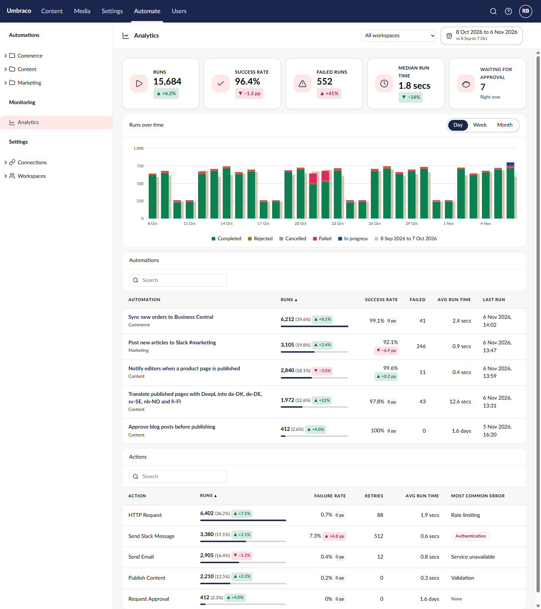
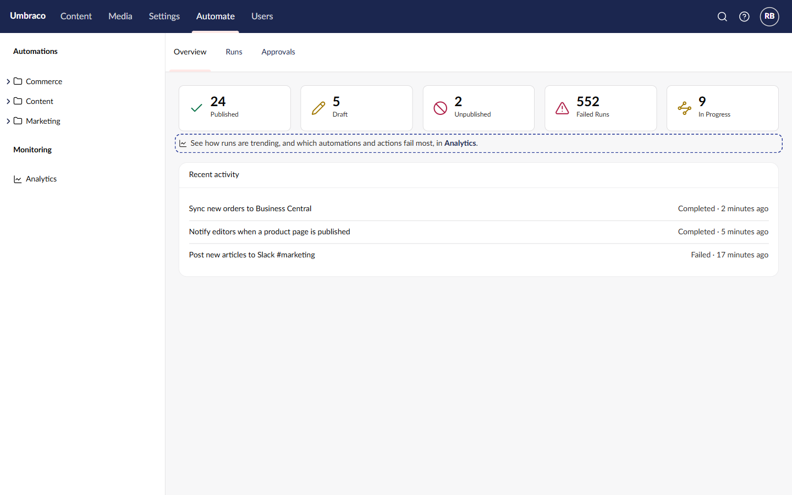

# Spec: Automate Analytics

## Endpoints
Base path: `/umbraco/automate/management/api/v1/metrics/analytics`

All three take the same query:

```text
from          date      required  first day, in timeZone
to            date      required  last day, inclusive
compareFrom   date      optional  with compareTo, the comparison period
compareTo     date      optional
workspaceId   guid      optional  one workspace; all accessible ones when missing
timeZone      string    required  IANA name, such as Europe/Copenhagen
```

**`GET /summary`** the tiles and the chart
- **200**

  ```ts
  {
    current: Period;
    compare: Period | null;        // null without compare dates, or when its runs are deleted (R7)
    waitingForApproval: number;    // right now, ignores the range (R6)
    retainedFrom: string | null;   // oldest day still kept, null when cleanup is off
  }
  Period = {
    runs: number;                  // every run started in the period
    completed: number; rejected: number; cancelled: number; failed: number; inProgress: number;
    successRate: number | null;    // 0..1, null when nothing finished (R4)
    medianDurationMs: number | null;
    days: { date: string; completed: number; rejected: number;
            cancelled: number; failed: number; inProgress: number }[];  // every day, zeros included
  }
  ```
- **400** a bad query (R10)

**`GET /automations`** the automations table
- **200** `{ items: AutomationRow[]; compareItems: AutomationRow[] | null }`

  ```ts
  AutomationRow = {
    automationId: string; name: string; workspaceName: string;
    runs: number; failed: number;
    successRate: number | null; avgDurationMs: number | null;
    lastRunUtc: string;            // latest start in the period
  }
  ```
- **400** a bad query (R10)

**`GET /actions`** the actions table
- **200** `{ items: ActionRow[]; compareItems: ActionRow[] | null }`

  ```ts
  ActionRow = {
    actionAlias: string;           // the browser looks up the name (ARCHITECTURE)
    runs: number; failed: number; retries: number;
    failureRate: number | null; avgDurationMs: number | null;
    topErrorCategory: string | null;   // a StepRunErrorCategory name (R9)
  }
  ```
- **400** a bad query (R10)

## Rules
- **R1** All three endpoints need access to the Automate section. A non-admin only gets runs of automations in workspaces their user groups can access. A `workspaceId` they can't access returns zeros and empty lists, not 403, the same as the existing metrics endpoints.
- **R2** A run belongs to the day its `StartedUtc` falls on in `timeZone`, including on days the clocks change. A run with no start time isn't counted.
- **R3** Workspace is the automation's current workspace. Runs of a deleted automation aren't counted, the same as the run list.
- **R4** Success rate = (completed + rejected) ÷ (completed + rejected + cancelled + failed). Runs still pending, running or suspended aren't in it. With no finished runs it's `null`, and the tile shows a dash with no badge.
- **R5** For a run, median and average run time come from `DurationMs`. For an action, average run time comes from `DurationTicks`. Both only use finished runs. Retries are the sum of `RetryCount`.
- **R6** Waiting for approval is the number of runs with status Suspended right now, scoped as in R1, whatever the range.
- **R7** `compare` and `compareItems` are `null` when the comparison period starts before `retainedFrom`. Badges and compare bars are then hidden, and the tile says "No comparison: the earlier period was deleted".
- **R8** For an action, a run is a step run with a start time and any status except Skipped. Failure rate = failed ÷ (completed + failed + rejected). A step run belongs to the day it started, not the day its run started.
- **R9** The most common error is the error category with the most failed step runs in the period. On a tie, the lower enum value wins. With no failures it's `null`, shown as "None". `Unknown` is shown as "Other".
- **R10** 400 with `ProblemDetails` when: `timeZone` isn't a known IANA name; `from` is after `to`; the range is longer than 366 days; only one of `compareFrom` and `compareTo` is given; or the comparison isn't the same length as the range.
- **R11** The date range, comparison and workspace are remembered per backoffice user in this browser. Reopening Analytics shows what they last picked, as long as the workspace is still one they can access.
- **R12** Only Automate's existing permissions apply. Nothing here changes data.
- **R13** The date range offers Last 7 days, Last 30 days, Last 90 days and Custom, and opens on the last 30 days compared with the 30 before. A custom range can be up to 366 days and can't end after today.
- **R14** The chart groups by Day, Week or Month. Hour isn't offered, even for a one- or two-day range.
- **R15** Both tables load all their rows in one call and sort and search in the browser. The automations table lists every automation with a run in the range, the actions table every action that ran; neither is paged.
- **R16** Only the Waiting for approval tile is a link; it opens the Approvals dashboard.
- **R17** The workspace select is hidden for a user who can access only one workspace.

## Analytics
Opens from **Monitoring → Analytics** in the Automate section sidebar.



[Mockup source](./mockups/analytics.html)

| When | The screen |
|---|---|
| First open | Last 30 days vs the 30 before, all workspaces (R13) |
| Loading | Each tile, the chart and each table show their own skeleton |
| A box fails to load | That box shows "Couldn't load…" with Retry; the others still show |
| No runs in the range | The chart says "No runs in this period"; tiles show 0 or a dash |
| Range starts before retention | An info line above the tiles; no comparison (R7) |
| Date range or workspace changes | All three endpoints reload; any older answers still on the way are dropped |
| Day / Week / Month | Only the chart changes; nothing is fetched |
| Automation name clicked | Opens that automation |
| Waiting for approval clicked | Opens the Approvals dashboard |

- **First run.** A site with no runs at all shows the empty state above. The tiles show 0 runs, and dashes for the success rate and median run time.
- **Mistake.** There's nothing to type. The date dialog won't save a range that ends after today. A bad query from elsewhere gets a 400 (R10), shown as the error state.
- **Wait.** Every box loads on its own, as Analytics UI's load states do, so a slow actions query doesn't hold up the tiles.
- **Finish.** Nothing to finish: it's read only.
- **Return.** R11.

States not shown full size: [empty](./mockups/analytics-empty.png), [load error](./mockups/analytics-error.png), [deleted runs](./mockups/analytics-retention.png). Open the mockup with `#empty`, `#error` or `#retention` to see each. In the deleted-runs picture the header still shows the default range; in the real screen it shows the chosen range.

Chart series, bottom to top: Completed (positive), Rejected (warning), Cancelled (default), Failed (danger), In progress (series 1), so the bars add up to the Runs tile. Compare bars sit behind, as Analytics UI draws them. Status colours come from Analytics UI's `color` names, never fixed colours.

## Overview dashboard
The existing Overview tab, with one new line.



[Mockup source](./mockups/overview.html)

The line sits under the status cards, and its link opens Analytics. It doesn't show in the welcome states (no workspaces, or no automations), because there's nothing to analyse yet. (The dashed outline in the mockup only marks the change.)

## Targets
- Each endpoint answers in under 2 seconds on SQL Server, with 500,000 runs and about 2,000,000 step runs over 90 days, a 90-day range with comparison, and all workspaces. It's measured by the seeded speed test (ARCHITECTURE), on the second call. If any endpoint misses, the feature is parked, as the brief says.
- No speed target on SQLite: it's for development sites.
- Every control on the page has a label and can be used from the keyboard. The page passes an axe check in the light, dark and high-contrast themes.
