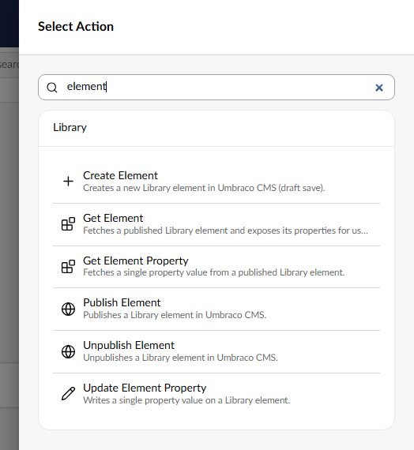
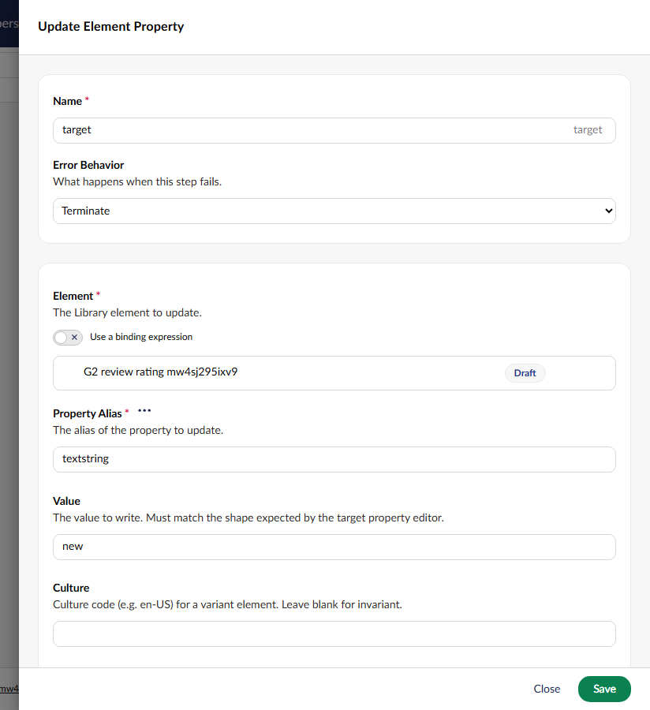
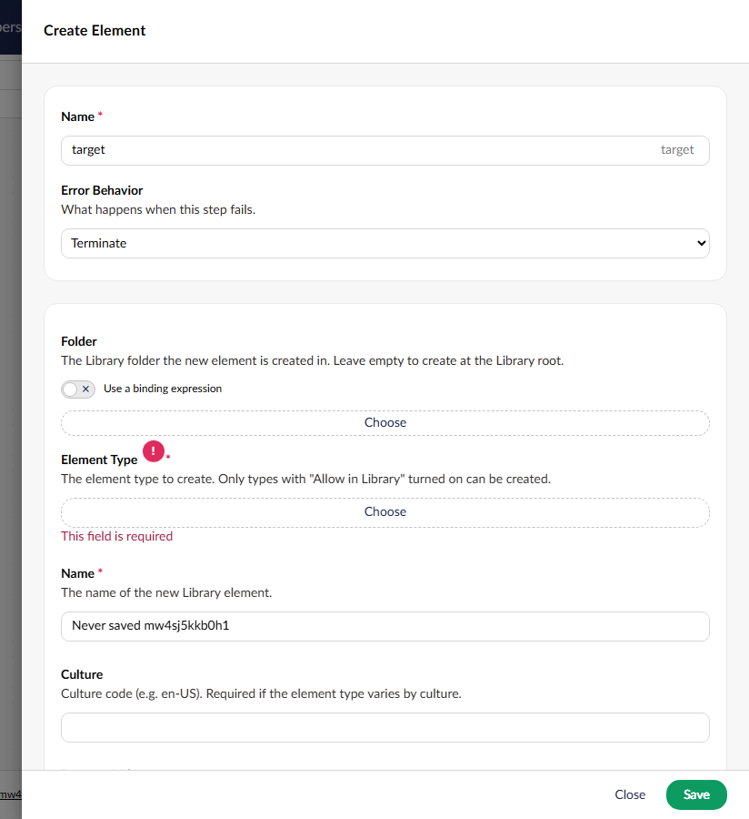
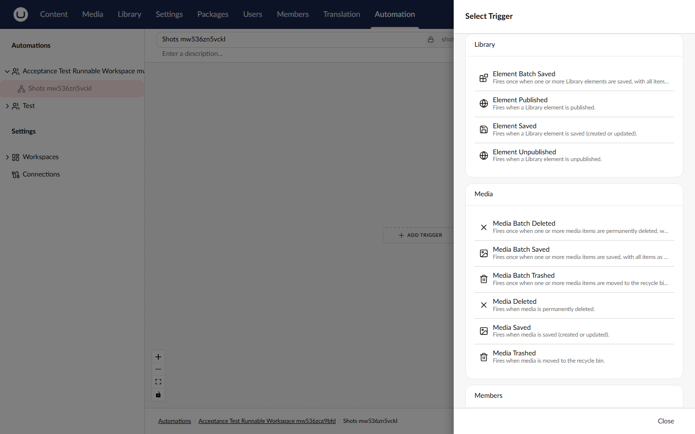
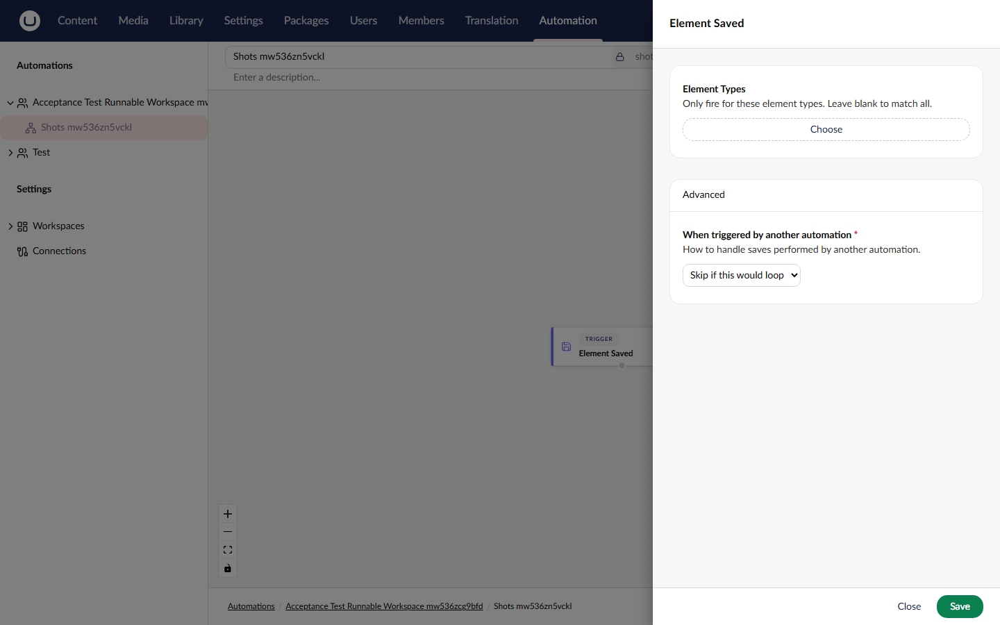

[Discussion #510](https://github.com/umbraco/Umbraco.Automate/discussions/510) | [Plan folder](https://github.com/umbraco/Umbraco.Automate/tree/24eef9f1a744577a769a6eaf4b9c79facabbdc1a/docs/plans/library-element-actions)

> [!IMPORTANT]
> **1 choice was made without you.** Please check it.
>
> **1. Design: the new trigger types are public**
>
> Plan said: one trigger per content trigger, "same settings and output shape". Nothing about visibility.
>
> Built: the 4 triggers, their 3 settings classes and 3 output classes are `public sealed`, as `ContentSavedTrigger` and its settings and output are ([ElementSavedTrigger.cs:18](https://github.com/umbraco/Umbraco.Automate/blob/24eef9f1a744577a769a6eaf4b9c79facabbdc1a/Umbraco.Automate/src/Umbraco.Automate.Core/Triggers/BuiltIn/ElementSavedTrigger.cs#L18), [ElementSavedTriggerOutput.cs:10](https://github.com/umbraco/Umbraco.Automate/blob/24eef9f1a744577a769a6eaf4b9c79facabbdc1a/Umbraco.Automate/src/Umbraco.Automate.Core/Triggers/BuiltIn/ElementSavedTriggerOutput.cs#L10)). The dispatch marker, the move check and the output mapping are internal. Package validation is off, so a later rename needs an `[Obsolete]` path by hand.
>
> - **a. Keep them public, matching the content triggers** *(recommended)*
> - b. Make them internal until someone asks to bind to them in code

> [!NOTE]
> **Rick's earlier calls on this PR.**
>
> On the 7 choices from the actions build, kept as built:
>
> - Public `AuthorizeElementAsync` / `AuthorizeElementParentAsync` overloads taking a list of permissions.
> - `ua-document-type-picker`, which adds the required check the CMS document type picker lacks.
> - The element picker opening the CMS element and folder picker modals itself.
> - Create Element's create and property save in one transaction.
> - Unpublish Element reporting the two invariant/variant mismatches as Validation.
> - The culture-from-type bug Update Element Property shares with Update Content and Media Property goes to one follow-up for all three (#575).
>
> Changed: Get Element and Get Element Property no longer write a success line to the run log, matching Get Content.
>
> On the triggers:
>
> - Element Saved skips moves, trash and restore, as Content Saved does. A property aliased `parentId` or `trashed` makes an edit to it look like a move; that's documented, not guarded.
> - Element Unpublished fires when a restore unpublishes an element, and the docs say so.
> - No Element Batch Published or Batch Unpublished: the CMS raises those one element at a time, so they'd always hold one item. Not a CMS bug; content works the same way.

## Why the change

Automations can now read, create, change, publish and unpublish Umbraco 18 Library elements, and start when one is saved, published or unpublished, so a shared snippet (like the G2 review rating that umbraco.com pages pick) can be kept up to date without anyone editing it by hand.

## What it looks like

**Where to find it:**
- Automation › a workspace with a service account › an automation › Add action › the Library group
- Any of the six Library steps › Settings
- Automation › an automation › Add trigger › the Library group
- The same, then pick any element trigger to see its settings

**Who can see it:** the actions and triggers show up when the workspace's service account has access to the Library section. Each step also needs that account's element permission (Read, Create, Update, Publish or Unpublish), including any permissions set on a Library folder. A trigger only starts a run for elements the account can read.

Step picker, filtered to "element":



Update Element Property settings, with an element picked:



Create Element settings, saved with Element Type empty:



Trigger picker, scrolled to the Library group:



Element Saved settings, with the loop setting at its default:



## How to verify

1. On a v18 demo site, create a Library element type with a text property (`customSchema`), a Library folder "Reviews" and an element "G2 review rating" in it, and publish the element. Create a page whose element picker picks it, with a template that prints the property.
2. In a workspace whose service account has the Library section, add an automation: Manual trigger → **Update Element Property** (pick the element, alias `customSchema`, a new value) → **Publish Element**. The picker opens the Library tree, and the binding switch works on the Element field.
3. Run it. Both steps complete, and the page shows the new value on its next load.
4. Point Update Element Property at an element in the Library recycle bin. The step takes **Not found** and nothing is saved.
5. Add **Create Element** with Folder "Reviews", an element type with "Allow in Library", a Name and some Property Values JSON. Run it: the element is created as a draft in "Reviews" with those values. Leave Element Type empty and save the step: it shows "This field is required".
6. Access: give the service account's group a permission set on "Reviews" without Create, and run Create Element again. The step fails, naming `Umb.Element.Create` and the folder.
7. Add a second automation with the **Element Saved** trigger and a Log Message step, and publish it. Edit and save "G2 review rating" in the Library: one run starts, with `elementKey`, `elementName` and `isNew: false` in its trigger data.
8. Move the element to another folder, send it to the recycle bin, and restore it. None of these starts an Element Saved run.
9. Change the trigger to **Element Unpublished**, publish the element, then send it to the recycle bin and restore it. The restore unpublishes it and starts one run.
10. Access: remove Read from the service account's permissions on "Reviews" and save the element again. No run starts.

## Good to know

- v18 only. CMS 17 has no element publishing service, so there's no port.
- Element Saved also runs when an element is published, because the CMS saves it first. Content Saved does the same.
- Restoring a folder from the recycle bin fires Element Unpublished once for each published element inside. Restoring content raises no event, so this is an element-only difference.
- An automation created through the API with no trigger settings skips "Skip if this would loop", for every trigger, not just these. It predates this PR and is filed as #583; the loop spec saves the setting as the backoffice does.
- The acceptance specs ran against a demo site on SQL Server LocalDB, as CI uses: 14 of 14 for the triggers, 15 of 15 for the actions. The local SQLite demo threw `database is locked` on content and element tests alike.
- Publishing an element updates pages that already rendered it on their next request, so there's no cache-refresh code. Checked on one page with no output cache.
- Follow-ups filed: #575 (the culture rule in all three Update Property actions), #576 (Create Content's Content Type doesn't enforce "required"), #577 (`CannotUnpublishWhenReferenced` reported as Unknown), #578 (a shared helper for the per-action copies), #583 (loop protection with empty trigger settings).
- The UmbracoDocs changes for the actions and triggers pages are drafted at the end of `BUILD-LOG.md`.

## Change outline

How every element step checks access and handles a missing or trashed element.


New and changed files in `Umbraco.Automate.Core`:

```diff
 Actions/BuiltIn/
+├── GetElementAction.cs / Settings / Output              # published element cache
+├── GetElementPropertyAction.cs / Settings / Output
+├── CreateElementAction.cs / Settings / Output           # CreateAsync, then Save, in one scope
+├── UpdateElementPropertyAction.cs / Settings / Output   # IElementService.Save
+├── PublishElementAction.cs / Settings / Output          # IElementPublishingService.PublishAsync
+└── UnpublishElementAction.cs / Settings / Output        # IElementPublishingService.UnpublishAsync
 Triggers/BuiltIn/
+├── ElementSavedTrigger.cs / Settings / Output           # ElementSavedNotification; skips move, trash, restore
+├── ElementBatchSavedTrigger.cs                          # same notification, one run per save with items
+├── ElementPublishedTrigger.cs / Settings / Output       # ElementPublishedNotification
+├── ElementUnpublishedTrigger.cs / Settings / Output     # ElementUnpublishedNotification
 └── ContentCultureHelpers.cs              # now takes IPublishableContentBase, shared with elements
 Dispatch/Authorization/
+├── IElementScopedTriggerOutput.cs        # internal marker on the element outputs
 └── NodeScopedTriggerDispatchAuthorizer.cs  # + element case: Umb.Element.Read for the service account
 Security/
 ├── IAutomationActionAuthorizer.cs        # + AuthorizeElementAsync (×2), AuthorizeElementParentAsync, fail-closed defaults
 ├── AutomationActionAuthorizer.cs         # + IElementPermissionService, IElementContainerPermissionService
 └── AutomationActionAuthorizerExtensions.cs  # + AuthorizeElementOrFailAsync
 Extensions/
 └── AutomationAuthorizationResultExtensions.cs  # + list-of-permissions overloads for elements
 Cms/
 ├── IContentValueNormaliser.cs            # + IPublishedElement overloads, default forwards content
 └── ContentValueNormaliser.cs             # one read path; content keeps its own Value overload
 Constants.cs                              # + ElementKeyPicker, DocumentTypePicker UI aliases
```

The triggers register themselves through their `[Trigger]` attribute, like the content triggers, so there's no composer change.

Backoffice registrations:

| Alias | Element | Change |
|---|---|---|
| `Umb.Automate.ElementKeyPicker` | `ua-element-key-picker` | Added: picks one element, or one folder with `folderOnly` |
| `Umb.Automate.DocumentTypePicker` | `ua-document-type-picker` | Added: CMS document type picker with a required check, also used for the triggers' Element Types |
| `uaOutcomes_folderNotFound`, `uaOutcomes_elementTypeNotFound` | `lang/en.ts` | Added: Create Element's outcome labels |

The six actions and four triggers:

| Action or trigger | Permission | Outcomes or output |
|---|---|---|
| Get Element | Read | Found (default), Not found |
| Get Element Property | Read | Found (default), Not found, Property not found |
| Create Element | Create (on the folder, or the Library root) | Created (default), Folder not found, Element type not found |
| Update Element Property | Update | Updated (default), Not found, Property not found |
| Publish Element | Publish | none: a missing or trashed element fails the step |
| Unpublish Element | Unpublish | none: a missing or trashed element fails the step |
| Element Saved | Read | `elementKey`, `elementName`, `contentTypeKey`, `contentTypeAlias`, `cultures`, `isNew` |
| Element Batch Saved | Read, per element | `items` (as Element Saved), `count` |
| Element Published | Read | as Element Saved, without `isNew` |
| Element Unpublished | Read | as Element Saved, without `isNew` |

<details>
<summary>Checked and fine (12)</summary>

- Create Element takes Property Values in Create Content's JSON format, setting them after the create (Rick's call, DECISION-LOG T10).
- The step picker reads Content, Core, Library, Media, sorted by name (Rick confirmed).
- The Element Type picker greys out page types instead of hiding them, as the CMS does (Rick confirmed; STORY-8 AC8 reworded).
- Folder access goes through `IElementContainerPermissionService`, because `IElementPermissionService` looks up element keys only at 18.1.0.
- Create Element checks a trashed folder itself: the CMS's create only checks that the folder exists.
- `IContentValueNormaliser` still reads content through the content `Value` overload, so content keeps the overridable fallback and per-content segment.
- `AuthorizeElementParentOrFailAsync` was removed before it shipped, because nothing called it.
- Element Saved's move check (`ElementSavedTrigger.IsEditSave`) was proved on the real site for move, trash, restore and restore of a published element.
- Each element trigger has its own settings class, as each content trigger does.
- SPEC R19 now also covers a folder restore, which follows from Rick's "fire, and document it" call (DECISION-LOG T19).
- The trigger dispatch check runs when the outbox message is handled, after the change commits, so a restored element isn't treated as trashed.
- The trigger screenshots show a narrower modal with labels above fields, where the mockups had them side by side. That's how every Automate settings modal looks; the content matches.

</details>

🤖 Generated with [Claude Code](https://claude.com/claude-code)

https://claude.ai/code/session_01NNrj1N3TENGjXFQaLmeS4S
