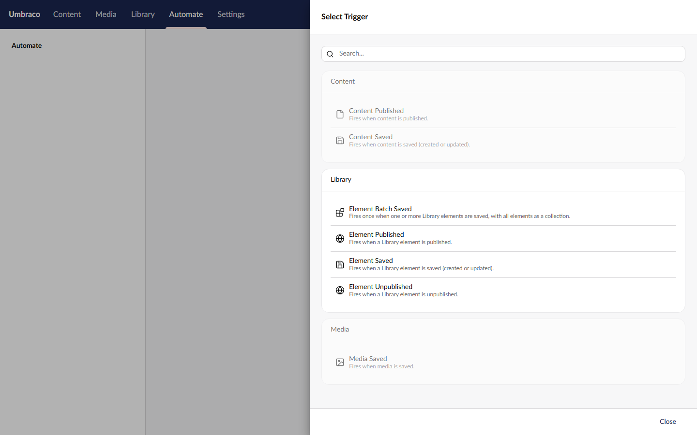
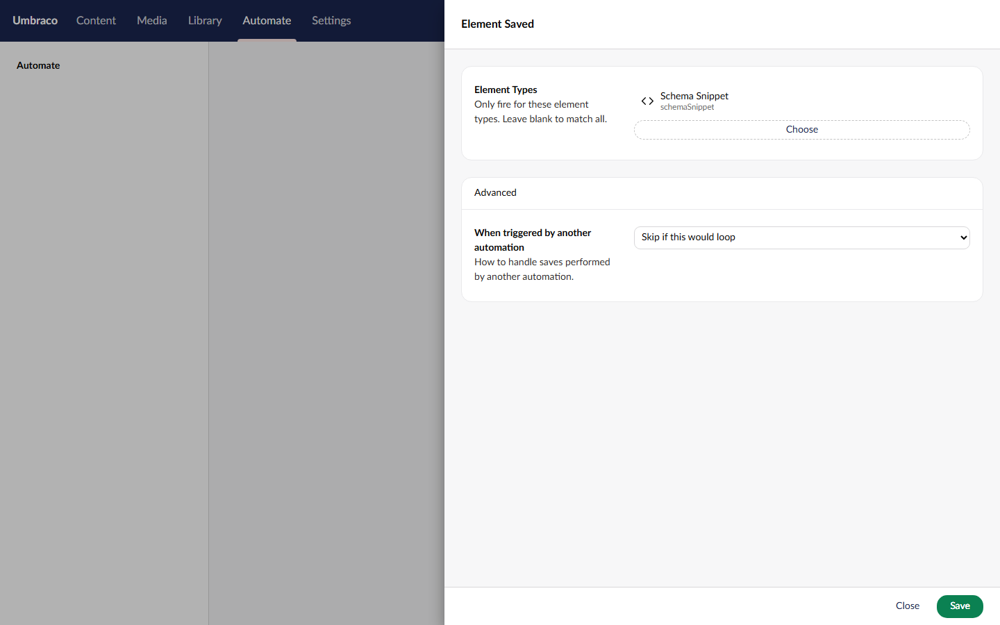

# Spec: Library element actions

## Endpoints
None. The step catalogue lists the new actions on its own.

## Actions

All six: group **Library**, section **Library** (`Constants.Applications.Library`), acting user is the workspace's service account.

**Get Element** · `umbracoAutomate.getElement` · `Umb.Element.Read` · icon `icon-plugin`
- **Settings:** Element (picker, required, bindable), Culture
- **Outcomes:** `success` "Found" (default), `notFound`
- **Output:** `ElementKey`, `Name`, `ContentTypeAlias`, `ContentTypeKey`, `Culture`, `AvailableCultures`, `CreateDate`, `UpdateDate`, `CreatorKey`, `WriterKey`, `Properties`. No URL, path, level or folder key: elements have no URL, and the published element doesn't carry the others.

**Get Element Property** · `umbracoAutomate.getElementProperty` · `Umb.Element.Read` · icon `icon-plugin`
- **Settings:** Element (picker, required, bindable), Property Alias, Culture
- **Outcomes:** `success` "Found" (default), `notFound`, `propertyNotFound`
- **Output:** `ElementKey`, `PropertyAlias`, `Culture`, `Value`, `HasValue`

**Create Element** · `umbracoAutomate.createElement` · `Umb.Element.Create` · icon `icon-add`
- **Settings:** Folder (folder picker, optional, bindable, must resolve), Element Type (element type picker, required), Name, Culture, Property Values (JSON)
- **Outcomes:** `success` "Created" (default), `parentNotFound` "Folder not found", `elementTypeNotFound` "Element type not found". `parentNotFound` keeps Create Content's key; both labels are new terms.
- **Output:** `ElementKey`, `Name`, `ContentTypeKey`, `ContentTypeAlias`, `FolderKey` (null at the Library root)

**Update Element Property** · `umbracoAutomate.updateElementProperty` · `Umb.Element.Update` · icon `icon-edit`
- **Settings:** Element (picker, required, bindable), Property Alias, Value, Culture, Segment
- **Outcomes:** `success` "Updated" (default), `notFound`, `propertyNotFound`
- **Output:** `ElementKey`, `PropertyAlias`, `Culture`, `Segment`, `PreviousValue`

**Publish Element** · `umbracoAutomate.publishElement` · `Umb.Element.Publish` · icon `icon-globe`
- **Settings:** Element (picker, required, bindable), Cultures (comma-separated, empty for invariant)
- **Outcomes:** none, like Publish Content. A missing or trashed element fails the step (R4).
- **Output:** `ElementKey`, `Cultures`

**Unpublish Element** · `umbracoAutomate.unpublishElement` · `Umb.Element.Unpublish` · icon `icon-globe`
- **Settings:** Element (picker, required, bindable), Cultures (comma-separated, empty for all)
- **Outcomes:** none, like Unpublish Content.
- **Output:** `ElementKey`, `Cultures`

Field labels and descriptions follow the content action they copy, with "content item" read as "Library element".

## Triggers

All four: group **Library**, section **Library**, each the counterpart of a content trigger. The per-element triggers start one run per element; Element Batch Saved starts one run with every element in a bulk save as a collection (`items`). There's no batch Published or Unpublished: CMS 18.1.0 raises one notification per element for those (content only batches re-published descendants, and elements have none), so they would always carry one item (Rick's call).

| Trigger | Alias | Counterpart | Icon |
|---|---|---|---|
| **Element Saved** | `umbracoAutomate.elementSaved` | Content Saved | `icon-save` |
| **Element Published** | `umbracoAutomate.elementPublished` | Content Published | `icon-globe` |
| **Element Unpublished** | `umbracoAutomate.elementUnpublished` | Content Unpublished | `icon-globe` |
| **Element Batch Saved** | `umbracoAutomate.elementBatchSaved` | Content Batch Saved | `icon-plugin` |

- **Settings (all four):** **Element Types** (element type picker, optional, "Only fire for these element types. Leave blank to match all."), and in the Advanced group **When triggered by another automation** (Always run / Skip if this would loop / Skip entirely, default Skip if this would loop). Same wording as the content triggers.
- **Output (per element):** `elementKey`, `elementName`, `contentTypeKey`, `contentTypeAlias`, `cultures`, and for Saved also `isNew`. Same shape as the content trigger outputs, in element terms. Element Batch Saved outputs `items`, a list of those.
- Descriptions follow the content trigger they copy, with "content" read as "a Library element".

## Rules
- **R1** An Element or Folder value that isn't a GUID once bindings resolve fails the step with a validation error.
- **R2** If the workspace's service account lacks the Library section, publishing an automation that uses one of these actions is refused with the existing "requires section access" error, a run fails the step, and the permission drift health check lists it. All existing section checks, nothing new.
- **R3** A service account whose start node or granular permissions don't cover the element (or the folder, for Create) fails the step with a permission reason, as content actions do. Permissions set on a Library folder apply to the elements in it.
- **R4** An element that doesn't exist takes `notFound` (Get, Get Property, Update) or fails the step (Publish, Unpublish).
- **R5** An element in the Library recycle bin is treated as in R4 for every service account, whether its Library start node is the root or a folder. Update writes nothing to it, and Unpublish doesn't touch it.
- **R6** Create Element with a folder that doesn't exist or is in the recycle bin takes `parentNotFound`, for every service account.
- **R7** Create Element with no folder creates at the Library root, and needs root access, as Create Content does at the content root.
- **R8** Create Element with an element type key that doesn't resolve takes `elementTypeNotFound`.
- **R9** Create Element with an element type that isn't "Allow in Library", or isn't allowed in that folder, fails the step with a validation error naming the type and the folder.
- **R10** Create Element takes Property Values in the same JSON format as Create Content and Update Element Property, and sets them the same way, so a value that would fail validation is still saved in the draft, as Create Content does. Values aren't validated on the way in.
- **R11** Update Element Property on a property alias the element type doesn't have takes `propertyNotFound` and writes nothing.
- **R12** Update Element Property changes only the one property, in the given culture and segment, and leaves the element's other values and its published version as they were.
- **R13** Culture works as in the content actions: blank on an invariant element is ignored, and blank on a culture-variant element means the element's first culture, for reads and for Update.
- **R14** After Publish Element succeeds, the published element cache returns the new values. Pages that pick the element show them on their next render.
- **R15** The four write actions add an audit entry under the service account, as the content write actions do.
- **R16** Each write action (Create, Update, Publish, Unpublish) writes one run log line naming the element (name and key), and Update says which culture and segment it wrote. The two Get actions write no success line, like Get Content (Rick's call on #574).

**Trigger rules**
- **R17** Saving, publishing or unpublishing a Library element in the backoffice, or through any CMS service, starts every published automation that uses the matching trigger, once per element for the per-element triggers and once per bulk save for Element Batch Saved.
- **R18** **Element Saved** doesn't fire when the save only moved the element to another folder, sent it to the recycle bin or restored it, matching Content Saved. The CMS raises a Saved notification for these moves on elements but not on content.
- **R19** **Element Unpublished** fires when restoring a published element from the recycle bin unpublishes it. The CMS really does unpublish it there; the docs say so. Restoring a folder fires it once for each published element inside. Content differs: restoring a published document unpublishes it without an event.
- **R20** With **Element Types** set, a trigger fires only for elements of those types. Element Batch Saved starts with the whole batch when any element matches, and doesn't start when none match, as Content Batch Saved does.
- **R21** A trigger fires only for elements the workspace's service account can read: the Library section, its Library start node, and Read permission including permissions set on a Library folder. A batch trigger leaves out the elements the account can't read, and doesn't start when none are left. An element in the recycle bin is hidden from an account whose Library start node is a folder.
- **R22** An element change made by an automation step (Create, Update, Publish or Unpublish Element) follows **When triggered by another automation**, as content changes do. With the default, an automation that changes an element can't start itself again through these triggers.
- **R23** `cultures` lists the cultures saved, published or unpublished in that operation, as the content triggers report them: null for an invariant element.
- **R24** `isNew` is true when the save created the element, as Content Saved works it out (the create and update dates match).

## Step picker
Opens from "Add a step" on the automation canvas.

[Mockup source](./mockups/step-picker.html)

| When | The screen |
|---|---|
| Typing in search | Element actions match on name and description, like the rest |
| Section missing | Listed as usual; publishing the automation is refused (R2) |

The Library group sits between Content and Media.

## Update Element Property settings
Opens when the author adds the step or clicks it on the canvas. Get Element, Get Element Property, Publish Element and Unpublish Element use the same Element field.

[Mockup source](./mockups/update-element-property.html)

| When | The screen |
|---|---|
| First open | Element is empty with a Choose button |
| Choose | The CMS's element picker modal opens on the Library tree, elements only |
| Binding switch on | Element becomes a binding text box, same as the content pickers since #443 |
| Save with Element empty | "This field is required" on Element |

## Create Element settings
Opens the same way.

[Mockup source](./mockups/create-element.html)

| When | The screen |
|---|---|
| Folder Choose | The element picker opens on the Library tree, folders only |
| Folder empty | Allowed; the element goes in the Library root |
| Element Type Choose | Lists element types only |
| Save with Element Type empty | "This field is required", as pictured |

## Trigger picker
Opens from the automation's trigger node when choosing or changing the trigger.

[Mockup source](./mockups/trigger-picker.html)

| When | The screen |
|---|---|
| Typing in search | Element triggers match on name and description, like the rest |
| Section missing | Listed as usual; publishing the automation is refused (R2) |

The Library group sorts between Core and Media, as the step picker's does.

## Element trigger settings
Opens when the author picks one of the four triggers or clicks the trigger node. All four show the same two fields.

[Mockup source](./mockups/element-saved-trigger.html)

| When | The screen |
|---|---|
| Element Types Choose | Lists element types; page types are greyed out, as in Create Element |
| Element Types empty | Allowed; the trigger fires for every element type |

## Targets
- None beyond the content actions: each step does one permission check, one load and one CMS call, the same as its content counterpart. The one agreed exception is Create Element with Property Values, which saves twice (`CreateAsync`, then `IElementService.Save`) so values use Create Content's format (DECISION-LOG, T10).
