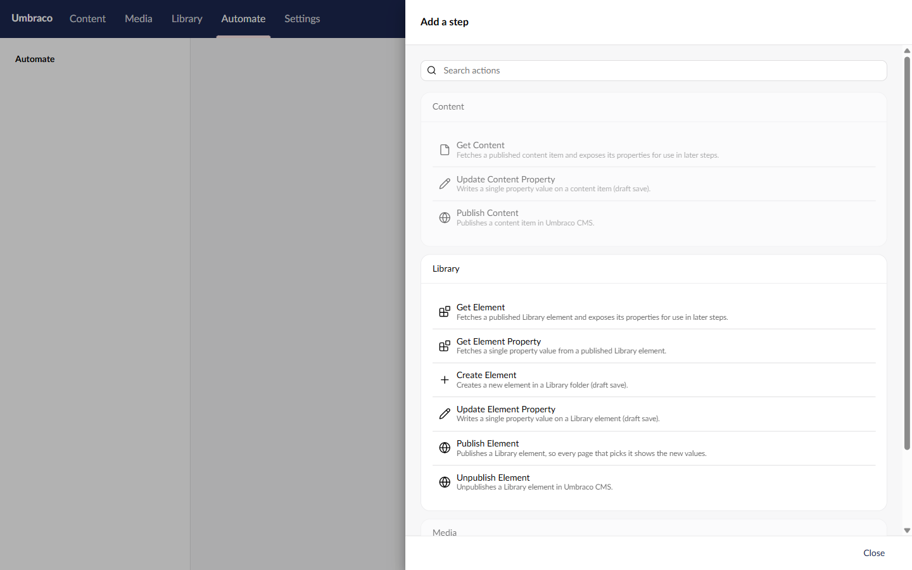
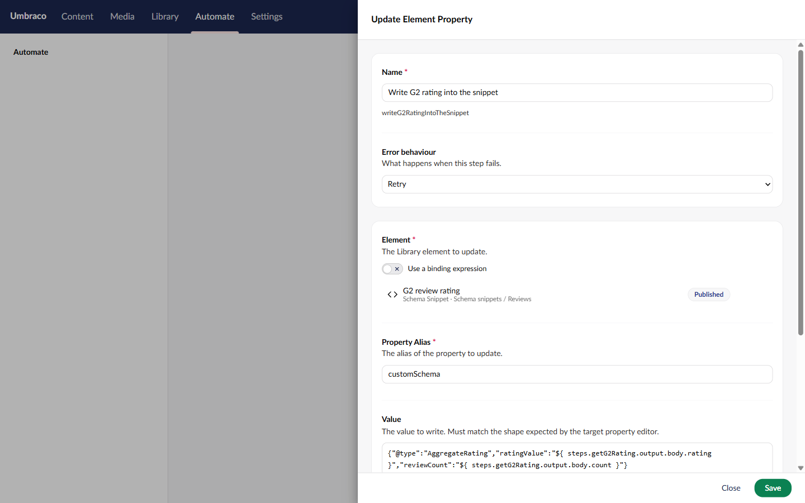
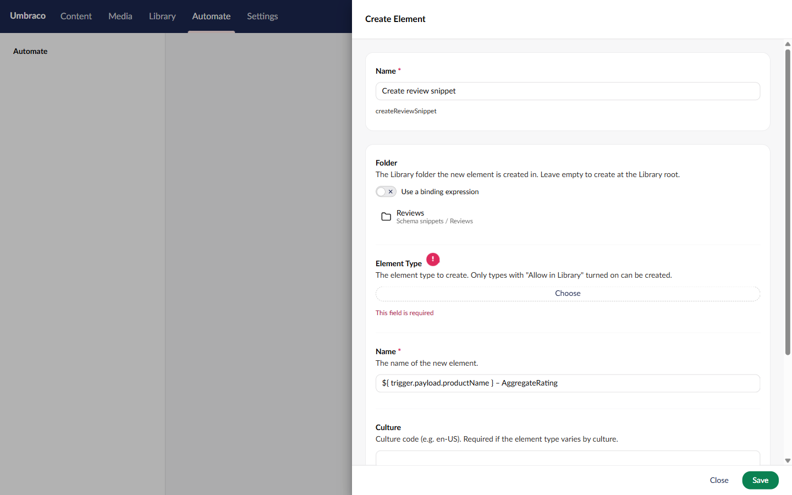

# Spec: Library element actions

## Endpoints
None. The step catalogue lists the new actions on its own.

## Actions

All six: group **Library**, section **Library** (`Constants.Applications.Library`), acting user is the workspace's service account.

**Get Element** · `umbracoAutomate.getElement` · `Umb.Element.Read` · icon `icon-plugin`
- **Settings:** Element (picker, required, bindable), Culture
- **Outcomes:** `success` "Found" (default), `notFound`
- **Output:** `ElementKey`, `Name`, `ContentTypeAlias`, `ContentTypeKey`, `Culture`, `AvailableCultures`, `CreateDate`, `UpdateDate`, `CreatorKey`, `WriterKey`, `Properties`. No URL, path, level or folder key: elements have no URL, and the published element doesn't carry the others.

**Get Element Property** · `umbracoAutomate.getElementProperty` · `Umb.Element.Read` · icon `icon-plugin`
- **Settings:** Element (picker, required, bindable), Property Alias, Culture
- **Outcomes:** `success` "Found" (default), `notFound`, `propertyNotFound`
- **Output:** `ElementKey`, `PropertyAlias`, `Culture`, `Value`, `HasValue`

**Create Element** · `umbracoAutomate.createElement` · `Umb.Element.Create` · icon `icon-add`
- **Settings:** Folder (folder picker, optional, bindable, must resolve), Element Type (element type picker, required), Name, Culture, Property Values (JSON)
- **Outcomes:** `success` "Created" (default), `parentNotFound` "Folder not found", `elementTypeNotFound` "Element type not found". `parentNotFound` keeps Create Content's key; both labels are new terms.
- **Output:** `ElementKey`, `Name`, `ContentTypeKey`, `ContentTypeAlias`, `FolderKey` (null at the Library root)

**Update Element Property** · `umbracoAutomate.updateElementProperty` · `Umb.Element.Update` · icon `icon-edit`
- **Settings:** Element (picker, required, bindable), Property Alias, Value, Culture, Segment
- **Outcomes:** `success` "Updated" (default), `notFound`, `propertyNotFound`
- **Output:** `ElementKey`, `PropertyAlias`, `Culture`, `Segment`, `PreviousValue`

**Publish Element** · `umbracoAutomate.publishElement` · `Umb.Element.Publish` · icon `icon-globe`
- **Settings:** Element (picker, required, bindable), Cultures (comma-separated, empty for invariant)
- **Outcomes:** none, like Publish Content. A missing or trashed element fails the step (R4).
- **Output:** `ElementKey`, `Cultures`

**Unpublish Element** · `umbracoAutomate.unpublishElement` · `Umb.Element.Unpublish` · icon `icon-globe`
- **Settings:** Element (picker, required, bindable), Cultures (comma-separated, empty for all)
- **Outcomes:** none, like Unpublish Content.
- **Output:** `ElementKey`, `Cultures`

Field labels and descriptions follow the content action they copy, with "content item" read as "Library element".

## Rules
- **R1** An Element or Folder value that isn't a GUID once bindings resolve fails the step with a validation error.
- **R2** If the workspace's service account lacks the Library section, publishing an automation that uses one of these actions is refused with the existing "requires section access" error, a run fails the step, and the permission drift health check lists it. All existing section checks, nothing new.
- **R3** A service account whose start node or granular permissions don't cover the element (or the folder, for Create) fails the step with a permission reason, as content actions do. Permissions set on a Library folder apply to the elements in it.
- **R4** An element that doesn't exist takes `notFound` (Get, Get Property, Update) or fails the step (Publish, Unpublish).
- **R5** An element in the Library recycle bin is treated as in R4 for every service account, whether its Library start node is the root or a folder. Update writes nothing to it, and Unpublish doesn't touch it.
- **R6** Create Element with a folder that doesn't exist or is in the recycle bin takes `parentNotFound`, for every service account.
- **R7** Create Element with no folder creates at the Library root, and needs root access, as Create Content does at the content root.
- **R8** Create Element with an element type key that doesn't resolve takes `elementTypeNotFound`.
- **R9** Create Element with an element type that isn't "Allow in Library", or isn't allowed in that folder, fails the step with a validation error naming the type and the folder.
- **R10** Create Element with property values that fail validation still saves the element as a draft, as the backoffice does, and writes a run log warning naming the properties.
- **R11** Update Element Property on a property alias the element type doesn't have takes `propertyNotFound` and writes nothing.
- **R12** Update Element Property changes only the one property, in the given culture and segment, and leaves the element's other values and its published version as they were.
- **R13** Culture works as in the content actions: blank on an invariant element is ignored, and blank on a culture-variant element means the element's first culture, for reads and for Update.
- **R14** After Publish Element succeeds, the published element cache returns the new values. Pages that pick the element show them on their next render.
- **R15** The four write actions add an audit entry under the service account, as the content write actions do.
- **R16** Each action writes one run log line naming the element (name and key), and Update says which culture and segment it wrote.

## Step picker
Opens from "Add a step" on the automation canvas.

[Mockup source](./mockups/step-picker.html)

| When | The screen |
|---|---|
| Typing in search | Element actions match on name and description, like the rest |
| Section missing | Listed as usual; publishing the automation is refused (R2) |

The Library group sits between Content and Media.

## Update Element Property settings
Opens when the author adds the step or clicks it on the canvas. Get Element, Get Element Property, Publish Element and Unpublish Element use the same Element field.

[Mockup source](./mockups/update-element-property.html)

| When | The screen |
|---|---|
| First open | Element is empty with a Choose button |
| Choose | The CMS's element picker modal opens on the Library tree, elements only |
| Binding switch on | Element becomes a binding text box, same as the content pickers since #443 |
| Save with Element empty | "This field is required" on Element |

## Create Element settings
Opens the same way.

[Mockup source](./mockups/create-element.html)

| When | The screen |
|---|---|
| Folder Choose | The element picker opens on the Library tree, folders only |
| Folder empty | Allowed; the element goes in the Library root |
| Element Type Choose | Lists element types only |
| Save with Element Type empty | "This field is required", as pictured |

## Targets
- None beyond the content actions: each step does one permission check, one load and one CMS call, the same as its content counterpart.
